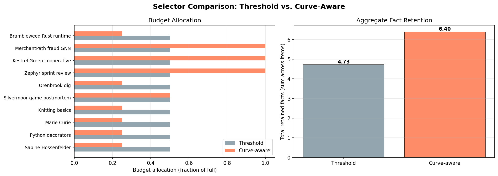
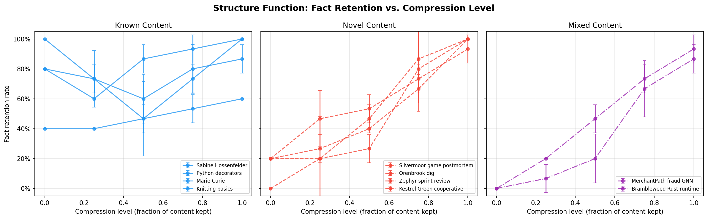
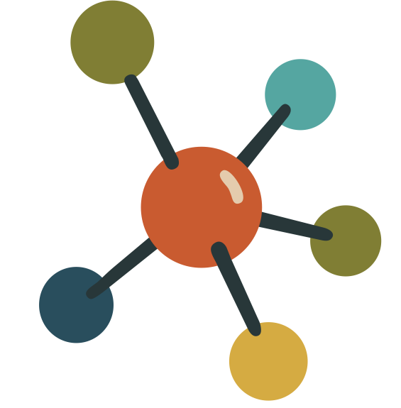

<p align="center">  </p>

> 🔸 Spend an LLM's context budget where it actually buys you something — using the math that already solved this, decades ago.

   

Every RAG pipeline, agent, and memory layer constantly makes the same decision: of everything it *could* put in the context window — retrieved passages, past turns, stored memories — what does it actually keep, and compressed how far? **LM Recall treats that as a question with a correct answer, not a knob to tune** — and shows the answer was worked out long ago in statistical decision theory.



*Same total budget, two ways to spend it (single-decoder MVP shown). A flat threshold gives every item the same slice. The curve-aware selector reads each item's retention curve and spends where context actually buys facts, while starving what the model already knows — retaining **6.40 vs 4.73** facts on the same budget. More memory, for free, just by allocating it right.*

> ➔ **The claim** — the two correct objects for this decision already exist, and are uncited across the entire RAG / prompt-compression / KV-cache / LLM-memory literature: Le Cam **deficiency** (which context is *sufficient* to keep) and the Vereshchagin–Vitányi **structure function** (how far to compress what you keep), both defined against a *fixed decoder* — which is exactly the situation of every model in production.

> ➔ **The result** — across **seven frozen decoders** (proprietary API + open-weight local), a selector built on these objects beats its baselines in **100% of stratified-bootstrap resamples (+29–78%)**, with gains **≥ 6.5× larger** on content the model can't already reconstruct.

<div style="page-break-after: always;"></div>

## 💡 How it works

The whole idea fits in one picture.



*Fact retention as you compress an item's context, for three kinds of content. **Known** content (left) stays high even at zero context — the model rebuilds it from training, so keeping it is nearly wasted budget. **Novel** content (middle) collapses without context and climbs steeply as you add it back — this is where budget earns its keep. **Mixed** sits between.*

The shape of that curve *is* the value of the context. A good selector spends budget on steep curves and starves flat ones — and "steep vs flat, relative to a fixed decoder" isn't a heuristic, it's a named mathematical object:

- **What to keep** — comparing candidate contexts by *deficiency* (Blackwell 1951, Le Cam 1964): the context you want is the one approximately **sufficient** for the decoder's task, and deficiency measures exactly what you give up by keeping less.
- **How far to compress it** — the conditional **structure function** (Vereshchagin & Vitányi 2004): the parameter-free line between the part of a string that is structure (keep) and the part that is incidental (drop), measured against a fixed decoder.

Neither object appears in the literature this problem lives in, even as that literature keeps reinventing weaker cousins — information-bottleneck surrogates, KL-scoring, attention salience. LM Recall is the demonstration that the real objects also win in practice.

And the minimal *sufficient* context is also the cheapest one: fewer tokens, less compute, less energy per query. Getting the object right and getting the bill down are the same move.

**Reported as plainly as the wins:** the pre-registered scaling prediction didn't hold cleanly — a decoder's response *style* dominated raw parameter count. One decoder's U-shaped curve shows the simple two-bucket allocator underspecifies the problem. And the corpus is n = 30: this is a demonstration that the objects are correct and operational, not a benchmark sweep. The mathematics is the contribution; the experiments corroborate it.

<div style="page-break-after: always;"></div>

## ➡️ What's in here

| Path | What it is |
|---|---|
| `multimodel/` | The cross-decoder experiment: the structure-function `selector`, plus `scoring`, `compression`, and `bootstrap`; one `run_*.py` per decoder; raw per-decoder outputs in `results/`. `aggregate_cross_decoder.py` builds the comparison table and figures. |
| `mvp/` | The original single-decoder demonstration that started it: a notebook computing retention curves and the structure-function selector, plus the theory note (`mvp_theory.md`), a write-up (`mvp_report.md`), and the figures above. |
| `verification/` | The 30-item corpus (`new_corpus.py`, with the earlier `corpus.py`) and the ground-truth retention measurements (`measure_ground_truth*.py`, `ground_truth_results*.json`). |

This started as a build, not a theorem. The selector in `mvp/` was running before its justification was found; the structure-function grounding came last. That chronology is the point — the maths was discovered to already describe a thing that worked.

## Reproduce

Python 3.13+.

```bash
pip install -r requirements.txt
cp .env.example .env        # add keys for whichever decoders you'll run
```

**API decoders** — run the matching script:

```bash
python multimodel/run_claude_haiku.py
python multimodel/run_gpt.py
python multimodel/run_gemini.py
# ...one per decoder
```

**Local / open-weight decoders** — load the model into a local OpenAI-compatible server (vLLM, llama.cpp, Ollama, …), set `base_url` (and `model_id` if your server needs it) in the matching `run_*.py`, then run it.

**Aggregate** the per-decoder outputs into the cross-decoder table and figures:

```bash
python multimodel/aggregate_cross_decoder.py
```

**The MVP**: open `mvp/mvp_structure_function.ipynb` (an executed copy is included).

Raw outputs for all seven decoders are already in `multimodel/results/`, so the aggregation and figures regenerate without spending a single API call.

<div style="page-break-after: always;"></div>

## 📖 Companion writing

LM Recall is the code-and-data half of a cluster. The argument is made in full in four companion pieces, each with its own DOI:

- **Map essay** — *The Object the Field Keeps Reaching For* — `DOI: 10.5281/zenodo.20799732`
- **Essay I** — *Context Selection Has Been a Solved Problem Since 1951* (Blackwell / Le Cam) — `DOI: 10.5281/zenodo.20800031`
- **Essay II** — *Pointer or Preserve? Kolmogorov's Structure Function Already Answers* (Vereshchagin–Vitányi) — `DOI: 10.5281/zenodo.20800098`
- **Paper** — *Context Selection as Approximate Sufficiency: Le Cam Deficiency and Kolmogorov's Structure Function Against a Fixed Decoder* — `DOI: 10.5281/zenodo.20800175`

DOIs are reserved on Zenodo and dropped in at release.

## Citation

```
Pia Alpila (2026). LM Recall: context selection as approximate sufficiency
against a fixed decoder. Zenodo. DOI: 10.5281/zenodo.20800209
```

ORCID: [0009-0000-1457-7714](https://orcid.org/0009-0000-1457-7714)

## License

The repository is two kinds of thing, so it carries two licenses — pick by file type:

| Material | Files | License |
|---|---|---|
| Code | `*.py`, `*.ipynb` | **MIT** — see `LICENSE.txt` |
| Data, text, figures | `*.json`, `*.md`, `*.png` | **CC BY 4.0** — see `LICENSE-DATA.txt` |

Both are permissive: use it, build on it, ship it commercially. The only ask — on the writing, data, and ideas — is attribution. The recognition is the whole contribution, and carrying the credit forward is the one thing the license insists on.

## Author

**Pia Alpila** — ORCID [0009-0000-1457-7714](https://orcid.org/0009-0000-1457-7714)

<p align="right">  </p>
