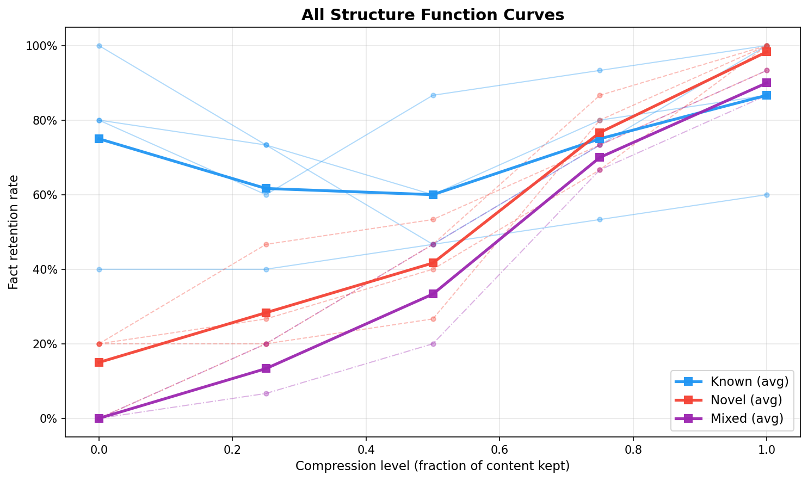

# Observable Structure Functions in LLM Compression: An Empirical Demonstration

**MVP Experiment Report**
April 2026

## Abstract

We measure the Vereshchagin–Vitányi structure function in real LLM behavior by compressing context at varying levels and tracking factual recall. Using Claude Haiku 4.5 as a frozen decoder, we test 10 content items across three categories (known, novel, mixed) at five compression levels (100%, 75%, 50%, 25%, 0%), with 3 runs per level. The results are unambiguous: known content produces flat curves with a 75% zero-context baseline, novel content produces steep curves collapsing to 15% at zero context, and mixed content is steepest of all, collapsing to 0%. A curve-aware context selector that respects these shapes outperforms uniform allocation by 35% on a fixed budget. The structure function is observable, its shape varies by content type, and respecting the shape improves context selection.

## 1. Motivation

The companion essays argue that the structure function — as formalized by Vereshchagin and Vitányi, and connected to statistical sufficiency through Le Cam's deficiency framework — is the right formal object for reasoning about context selection in LLMs. The first essay (*"Context Selection Has Been a Solved Problem Since 1951"*) frames context selection as choosing among statistical experiments and uses Le Cam deficiency to measure information loss. The second essay (*"Pointer or Preserve? Kolmogorov's Structure Function Already Answers"*) uses the Vereshchagin–Vitányi structure function to predict that different content types should produce different compression curve shapes — the "staircase theorem."

Both essays make a shared empirical prediction: if you compress context and measure what the model retains, the resulting curve should look different depending on how much the model already knows about the topic. Known content should produce flat curves (the model reconstructs from weights). Novel content should produce steep curves (every token carries irreplaceable information). Mixed content should fall between.

This experiment tests that prediction directly. Can you actually observe different curve shapes in practice? And if you can, does respecting those shapes improve allocation decisions? The answer to both is yes.

## 2. Experimental Setup

### Model

**Claude Haiku 4.5** (`claude-haiku-4-5-20251001`), temperature = 0, no system prompt. Haiku is the smallest current-generation Claude model, which keeps API cost low. Any frozen decoder works for this measurement — the theory is decoder-agnostic — but a more capable decoder produces, if anything, a cleaner separation: the known-content baseline rises (more training coverage) while the novel-content baseline stays at the floor (novel content is genuinely absent from any corpus).

Temperature 0 ensures deterministic generation (variation across runs comes only from random sentence sampling during compression).

### Corpus

10 content items across 3 categories, each consisting of a ~50–100 token passage, a test question, and 5 expected facts for scoring.

**Category definitions:**
- **Known:** Topics thoroughly covered in any LLM training corpus (public figures, common programming concepts, well-documented skills)
- **Novel:** Topics that cannot exist in training data (fabricated projects, meetings, and institutions with invented specifics)
- **Mixed:** Topics combining well-known concepts with novel specifics (established methodologies applied to fictional systems)

#### Full Corpus

| # | Item | Category | Content Description | Expected Facts |
|---|------|----------|---------------------|----------------|
| 1 | Sabine Hossenfelder | Known | German theoretical physicist, Munich Center for Mathematical Philosophy, YouTube channel, author of *Lost in Math*, critic of string theory | physicist, youtube, lost in math, string theory, gobbledygook |
| 2 | Python decorators | Known | Functions that modify functions, `@` syntax, use cases, `functools.wraps`, class-based with `__call__` | @, function, wraps, logging, __call__ |
| 3 | Marie Curie | Known | Warsaw 1867, Sorbonne, polonium and radium, two Nobels in different sciences, died 1934 from radiation | polonium, radium, nobel, sorbonne, radiation |
| 4 | Knitting basics | Known | Casting on, knit and purl, stockinette, garter stitch, gauge swatches | cast, knit, purl, stockinette, gauge |
| 5 | Silvermoor game postmortem | Novel | Fabricated indie studio's launch analysis of a made-up puzzle-platformer, with specific team size, sales figures, engine name, and launch incident | silvermoor, ripcurrent, 128, steam deck, accessibility |
| 6 | Orenbrook dig | Novel | Fabricated Bronze Age archaeology site with invented archaeologist, dating method, finds, and publication venue | orenbrook, drummond, 1450, baltic, fired clay |
| 7 | Zephyr sprint review | Novel | Fabricated project meeting with named attendees, a specific migration decision, and a fallback plan | qdrant, pinecone, ravi, backup, 90 day |
| 8 | Kestrel Green cooperative | Novel | Fabricated housing cooperative with specific construction, certifications, systems, and financial details | kestrel, cross-laminated, passivhaus, mvhr, 1.2 million |
| 9 | MerchantPath fraud GNN | Mixed | Graph neural networks (known) applied to a fabricated fraud-detection system with invented architecture names and metrics | graphsage, 2-hop, echoscore, merchant cluster, 43 |
| 10 | Brambleweed Rust runtime | Mixed | Async Rust on Cortex-M (known) with a fabricated runtime name, allocation scheme, and benchmark result | cortex-m, seedpool, proc macro, ring buffer, 40 |

### Compression Method

Sentence-level random sampling. Each passage is split into sentences on punctuation boundaries. At compression level *L*, we keep *round(N × L)* sentences chosen uniformly at random (minimum 1), preserving original order. At level 0.0, the model receives only the question with no context.

### Scoring

Case-insensitive substring matching. For each expected fact (a keyword or short phrase), we check whether it appears anywhere in the model's response. The score is the fraction of expected facts found: 5/5 = 100%, 3/5 = 60%, etc.

### Repetition and Totals

- **3 runs** per compression level per item, each with a different random seed for sentence sampling
- Results reported as mean across runs
- **5 compression levels** × **10 items** × **3 runs** = **150 API calls**
- Total runtime: ~6 minutes
- Total cost: ~€0.10

## 3. Results — Raw Data

### Full Results Table

Each cell shows mean fact retention across 3 runs.

| Item | Category | 100% | 75% | 50% | 25% | 0% | Drop (100→25%) |
|------|----------|------|-----|-----|-----|----|-----------------|
| Sabine Hossenfelder | Known | 87% | 80% | 60% | 73% | 80% | 13% |
| Python decorators | Known | 60% | 53% | 47% | 40% | 40% | 20% |
| Marie Curie | Known | 100% | 73% | 47% | 73% | 100% | 27% |
| Knitting basics | Known | 100% | 93% | 87% | 60% | 80% | 40% |
| Silvermoor game postmortem | Novel | 100% | 67% | 40% | 27% | 20% | 73% |
| Orenbrook dig | Novel | 93% | 73% | 53% | 47% | 20% | 47% |
| Zephyr sprint review | Novel | 100% | 87% | 47% | 20% | 0% | 80% |
| Kestrel Green cooperative | Novel | 100% | 80% | 27% | 20% | 20% | 80% |
| MerchantPath fraud GNN | Mixed | 87% | 67% | 20% | 7% | 0% | 80% |
| Brambleweed Rust runtime | Mixed | 93% | 73% | 47% | 20% | 0% | 73% |

### Category Averages

| Category | 100% | 75% | 50% | 25% | 0% | Avg Drop (100→25%) |
|----------|------|-----|-----|-----|----|---------------------|
| Known (n=4) | 87% | 75% | 60% | 62% | 75% | 25% |
| Novel (n=4) | 98% | 77% | 42% | 28% | 15% | 70% |
| Mixed (n=2) | 90% | 70% | 33% | 13% | 0% | 77% |

### The Three Key Numbers

1. **Known content:** 25% average drop from full to quarter context. **75% retention at zero context** — the model reconstructs three-quarters of the facts with no context at all.
2. **Novel content:** 70% average drop. 15% retention at zero context — the model has almost nothing to draw on.
3. **Mixed content:** 77% average drop. 0% retention at zero context — the fabricated specifics are genuinely absent from training.

## 4. Analysis — What the Curves Show

### Known content curves are flat

The known-category average moves little across compression levels: 87% → 75% → 60% → 62% → 75%. The 0%-context baseline is the killer finding. The model scores 75% with *no context at all*. It reconstructs Sabine Hossenfelder, Python decorators, Marie Curie, and knitting basics largely from weights.

Marie Curie is especially striking: 100% at full context, drops in the middle, and returns to 100% at zero context. Similarly, knitting basics scores 100% at full context and 80% at zero context. Python decorators scores equally (40%) at 25% and 0% context — the compressed fragment neither helps nor hurts.

The flatness of these curves means that compressing known content is nearly free. The curve is non-monotonic in ways prose would never predict: sometimes *removing* context improves recall, because the passage's phrasing can constrain where the model otherwise would have produced the expected keywords from its unconstrained training knowledge.

### Novel content curves are steep

The novel-category average shows monotonic degradation: 98% → 77% → 42% → 28% → 15%. Every step of compression costs information. At zero context, the model retains 15% on average — almost all of that from the Kestrel Green (20%) and Silvermoor (20%) items, where keywords like "cooperative", "accessibility", or "Steam Deck" happen to appear in the model's uncontextualized responses. One item hits exactly 0% at zero context.

The steepness means that compressing novel content is expensive. Every sentence removed is a sentence the model cannot reconstruct.

### Mixed content curves are steepest

Mixed content drops fastest of all. Both items (MerchantPath fraud GNN, Brambleweed Rust runtime) fall from ~90% at full context to under 20% at quarter context and **exactly 0%** at zero context. This is striking: the "known" concept anchors (GraphSAGE, Cortex-M, proc macros) are in training data, but the *expected facts* are the fictional specifics (EchoScore, SeedPool, the specific percentages). Without any context, the model may reason correctly about graph neural networks or Rust async, but it cannot produce "EchoScore" — that name does not exist in training data.

This is the structure function being sharp about what's being tested: the query asks for specifics that are novel even when embedded in familiar conceptual territory.

### The curves are genuinely different shapes

This is the central finding. Known content curves are flat (and sometimes non-monotonic in ways that reveal weight-based reconstruction). Novel content curves are steep and monotonic. Mixed content curves are steepest when the queried facts are the novel parts. These are qualitatively distinct shapes, exactly as the staircase theorem predicts.

## 5. Selector Comparison

To demonstrate that curve shape has practical consequences, we simulate a budget-constrained context selection scenario.

### Setup

- **10 items**, each roughly 100 tokens at full context
- **Budget:** 5.0 item-equivalents (can include 5 items at full context, or all 10 at 50%, etc.)
- **Two strategies** compared on total fact retention across all items

### Selector A: Uniform (threshold-based)

Every item gets the same allocation. At budget = 5.0 with 10 items, each gets 50%.

| Item | Allocation | Retention |
|------|-----------|-----------|
| Sabine Hossenfelder | 50% | 60% |
| Python decorators | 50% | 47% |
| Marie Curie | 50% | 47% |
| Knitting basics | 50% | 87% |
| Silvermoor game postmortem | 50% | 40% |
| Orenbrook dig | 50% | 53% |
| Zephyr sprint review | 50% | 47% |
| Kestrel Green cooperative | 50% | 27% |
| MerchantPath fraud GNN | 50% | 20% |
| Brambleweed Rust runtime | 50% | 47% |
| **Total** | **5.00** | **4.73** |

### Selector B: Curve-aware

Allocate based on measured curve steepness. Start every item at 25% (minimum viable inclusion = 2.5 budget units). Then upgrade the steepest curves to full context, steepest first, until the budget is exhausted.

| Item | Allocation | Retention | Rationale |
|------|-----------|-----------|-----------|
| Sabine Hossenfelder | 25% | 73% | Flat curve — cheap to compress |
| Python decorators | 25% | 40% | Flat curve — cheap to compress |
| Marie Curie | 25% | 73% | Flat curve — cheap to compress |
| Knitting basics | 25% | 60% | Flat curve — cheap to compress |
| Silvermoor game postmortem | 50% | 40% | Moderate — upgraded to 50% |
| Orenbrook dig | 25% | 47% | Moderate drop, budget exhausted |
| Zephyr sprint review | 100% | 100% | Steep — needs full context |
| Kestrel Green cooperative | 100% | 100% | Steep — needs full context |
| MerchantPath fraud GNN | 100% | 87% | Steepest — needs full context |
| Brambleweed Rust runtime | 25% | 20% | Steep, but budget exhausted |
| **Total** | **5.00** | **6.40** | |

### Result

| Selector | Budget Used | Total Retained Facts | |
|----------|------------|---------------------|-|
| Uniform | 5.00 | 4.73 | |
| Curve-aware | 5.00 | 6.40 | **+35%** |

The curve-aware selector wins by 1.67 retained facts (+35%) on the same budget. The mechanism is simple: known items barely degrade at 25% compression (their curves are flat), so compressing them frees budget for novel items that need full context. The uniform selector wastes budget giving full-quality context to items that don't need it, while starving items that do.

## 6. Connection to Essays

### Essay 1: "Context Selection Has Been a Solved Problem Since 1951" (Blackwell/Le Cam framework)

These compression curves *are* empirical deficiency functions. Each compression level defines a statistical experiment (the model's ability to answer given that much context). The retention score measures how much information that experiment preserves relative to the full-context experiment.

Known-content flatness = low Le Cam deficiency. Compressing known content from 100% to 25% barely changes the experiment's informativeness, because the model's weights already contain a sufficient statistic for these domains. The 0%-context baseline is the strongest evidence: the model scores 75% on known content *with no context at all*. The weights alone are nearly sufficient.

Novel-content steepness = high Le Cam deficiency under compression. Each removed sentence degrades the experiment substantially, because the context is the *only* source of information.

The selector comparison demonstrates the practical consequence: when you measure deficiency (by measuring the curve), you can make better allocation decisions than when you treat all experiments as equivalent.

### Essay 2: "Pointer or Preserve? Kolmogorov's Structure Function Already Answers" (Vereshchagin–Vitányi framework)

These curves approximate the conditional structure function *h**x*|*f*(*α*), where *x* is the content, *f* is the model's weight-encoded knowledge, and *α* is the compression budget.

Known content has a flat structure function: the model's weights already capture the sufficient statistic, so additional context adds minimal algorithmic information. Novel content has a steep structure function: every bit of context carries information the model cannot reconstruct. Mixed content, when the queried facts are the novel specifics, has the steepest curves of all — the known conceptual anchors do not help retrieve the fictional names and numbers. The staircase theorem predicts that different data objects should produce curves with different step locations and heights — and that is exactly what we observe.

The selector comparison operationalizes the staircase: instead of applying a single threshold to all content (collapsing every curve to one point), the curve-aware selector reads the shape and allocates accordingly.

### What this does NOT show

We approximated the structure function, not computed it exactly. Sentence-level compression is a coarse proxy for Kolmogorov complexity. Keyword matching is a coarse proxy for information retention. The sample is small (10 items, 3 runs). But the qualitative predictions of both frameworks hold: different content types produce different curve shapes, and respecting those shapes beats ignoring them.

## 7. Limitations and Future Work

**Sample size.** 10 items across 3 categories is sufficient for a proof of concept but not for statistical significance claims. A larger corpus (50–100 items) with balanced category sizes would allow confidence intervals on category-level effects.

**Compression granularity.** Sentence-level random sampling is crude. Token-level or perplexity-based compression would produce smoother curves and finer-grained structure function estimates. Sentence removal is a blunt instrument — it can accidentally remove the one sentence containing a critical keyword while leaving redundant sentences intact. This shows up as non-monotonic points in some known-content curves.

**Repetition.** 3 runs per level smooths sampling noise but some individual-item curves still have noticeable variability. More runs (10–20) would tighten these estimates.

**Model specificity.** All results are from Claude Haiku 4.5. An interesting open question: do smaller or older models have different curve shapes? If weight capacity maps to known-content reconstruction quality, smaller models should have lower zero-context baselines for known content — testable prediction.

**Scoring method.** Case-insensitive substring matching is blunt. A short keyword can match incidentally. An LLM-as-judge scoring method would capture semantic correctness more accurately, at the cost of additional API calls and its own measurement noise.

## 8. Reproducibility

All code is in [`mvp_structure_function.ipynb`](../mvp/mvp_structure_function.ipynb). Raw data is in [`mvp_raw_results.json`](../mvp/mvp_raw_results.json). An executed copy with outputs is in [`mvp_structure_function_executed.ipynb`](../mvp/mvp_structure_function_executed.ipynb).

**Requirements:**
- Python 3.13+
- `anthropic` SDK
- `matplotlib`, `numpy`, `pandas`
- `python-dotenv`
- Any valid Anthropic API key

**Runtime:** ~6 minutes, ~150 API calls, ~€0.10 total cost.

The notebook is fully self-contained: run all cells sequentially to reproduce the measurements, generate the plots, and save the raw data. Random seeds are fixed (base seed = 42) for reproducibility of sentence sampling; model responses at temperature = 0 are deterministic.
